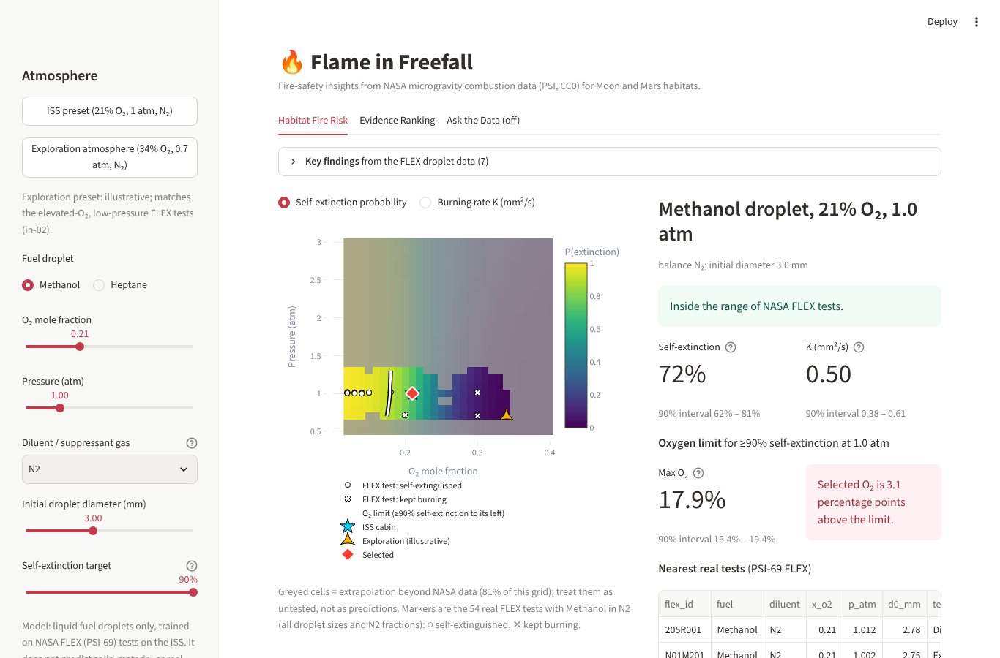

# Flame in Freefall

**NASA Space Apps Challenge 2026 · Hà Nội · Team "My team is kinda nameless"**
Challenge: *Flame in Freefall: AI-Powered Fire Safety Insights from Microgravity Combustion Data*

🥈 **Second Prize, NASA Space Apps Challenge 2026 — Hà Nội local event**

An interactive dashboard that summarizes, ranks and interprets NASA's microgravity combustion
experiments to answer one question for Moon and Mars habitats: **will a flame put itself out, and how
fast does it burn?**



## What NASA's data shows

- **Gravity changes the answer in both directions.** In SAFFIRE-II (PSI-99), a 0.27 mm silicone sheet
  burned completely at 1 g but almost not at all in microgravity, while cotton-fiberglass fabric burned
  its full 29 cm in microgravity.
- **0 of 17** FLEX droplet flames (PSI-69) self-extinguished at about 0.7 atm with 30–34% O₂, the
  elevated-oxygen, lower-pressure direction NASA describes for exploration atmospheres.
- **Oxygen is the strongest lever.** Near 1 atm in O₂/N₂, heptane flames self-extinguished in 11 of 14
  tests at ≤16% O₂, 5 of 17 at 20–22%, and 0 of 3 at 23–30%.

- **Oxygen limits.** For a 3 mm droplet in O₂/N₂ at 1 atm, the model puts the highest oxygen level at
  which a flame still self-extinguishes with 90% probability at 17.9% O₂ for methanol (90% interval
  16.4–19.4%) and 14.7% for heptane (12.7–16.5%).

All seven computed findings are in `insights/insights.json`; 27 cited findings from NASA tables and
documents are in `evidence/evidence.json`.

## The dashboard

| Tab | What it does |
|---|---|
| **Habitat Fire Risk** | Set oxygen, pressure, fuel and diluent gas; get the probability that a droplet flame self-extinguishes and its burning-rate constant K, with uncertainty bands and a risk map. Pick a self-extinction target (50%, 80% or 90%) to get the **oxygen limit**: the highest O₂ level that still meets it, drawn as a line on the map. Everything beyond NASA's data is greyed out. An *About the fuels* panel describes the two fuels the model covers. |
| **Evidence Ranking** | 27 findings ranked by relevance to habitat fire safety, each with its source and citation. |
| **Ask the Data** | Ask a question; an LLM answers only from the evidence, the insights and the model output, and must cite an id for every statement. |

## Run it

Requires [uv](https://docs.astral.sh/uv/).

```bash
uv run streamlit run app/app.py
```

The first two tabs need nothing else. For **Ask the Data**, set an [OpenRouter](https://openrouter.ai) key:

```bash
export OPENROUTER_API_KEY=sk-or-...
```

## Reproduce the numbers

```bash
uv run flame_model.py            # cross-validated model metrics and sample predictions
uv run scripts/clean_flex.py     # rebuild data/processed/flex_clean.csv from the raw NASA table
uv run scripts/make_insights.py  # rebuild insights/insights.json
uv run evidence/parse_bass2.py   # rebuild data/processed/bass2_structured.csv
```

Model: logistic regression (self-extinction) and ridge regression (burning rate K) on 274 FLEX tests,
with 200 bootstrap fits for uncertainty. Five-fold cross-validation grouped by test day:
ROC-AUC 0.881, balanced accuracy 0.762, R² 0.71 for K.

## Repository layout

| Path | Contents |
|---|---|
| `data/raw/` | Experimental tables from NASA's Physical Sciences Informatics (PSI) repository |
| `data/processed/` | Cleaned FLEX table and structured BASS-II table |
| `flame_model.py` | The models, the data-domain check and the evaluation |
| `scripts/` | Data cleaning and insight computation |
| `insights/insights.json` | Seven trends computed from FLEX data and the model |
| `evidence/` | Cited findings and the BASS-II parser |
| `app/` | Streamlit dashboard and screenshots |

## NASA data

From the [NASA PSI repository](https://psi.nasa.gov/physci/repo/search?q=combustion):
PSI-69 FLEX, PSI-68 FLEX-2, PSI-25 BASS-II, PSI-26 BASS, PSI-98 / PSI-99 / PSI-100 SAFFIRE I–III.
Evidence also cites NASA documents for these investigations and NASA's pages on the
[Apollo 1](https://sma.nasa.gov/sma-disciplines/accllp/apollo-1) and
[Mir](https://www.nasa.gov/history/25-years-ago-fire-aboard-space-station-mir/) fires.

## Limits

- The model covers **liquid fuel droplets only** (methanol and heptane). It does not predict fires in
  fabrics, plastics or real habitats; solid-material results appear only as cited evidence.
- The dataset is small (274 tests). About 81% of the default risk map is extrapolation and is greyed out.
- "Did not self-extinguish" includes tests that ended when the droplet was disrupted.
- The "Exploration atmosphere" preset is illustrative, not a NASA figure.
- The oxygen limit is a statistical estimate from the same model, not a flammability standard.
- FLEX-2 (PSI-68) tested more fuels (iso-octane, n-octane, decane, ethanol, propanol/glycerol mixtures),
  but its experimental table has no outcomes, so those fuels are not in the model yet.

## Use of AI

This project was built with AI assistance, as the challenge permits:

- **Claude (Anthropic), through Claude Code**, generated the code in this repository, the processed
  data tables, the evidence extraction in `evidence/evidence.json`, the insight computation and the
  written materials, under the direction and review of the participant.
- **The predictions** come from classical machine-learning models (scikit-learn), not from an LLM.
- **The Ask the Data tab** calls the LLM `z-ai/glm-5.3-flash` through OpenRouter at run time and
  restricts it to cited evidence.

No images, video or audio in this project were generated by AI; the screenshots are of the running app.

## Built with

Streamlit, Plotly, scikit-learn, pandas, NumPy, Requests, uv.
